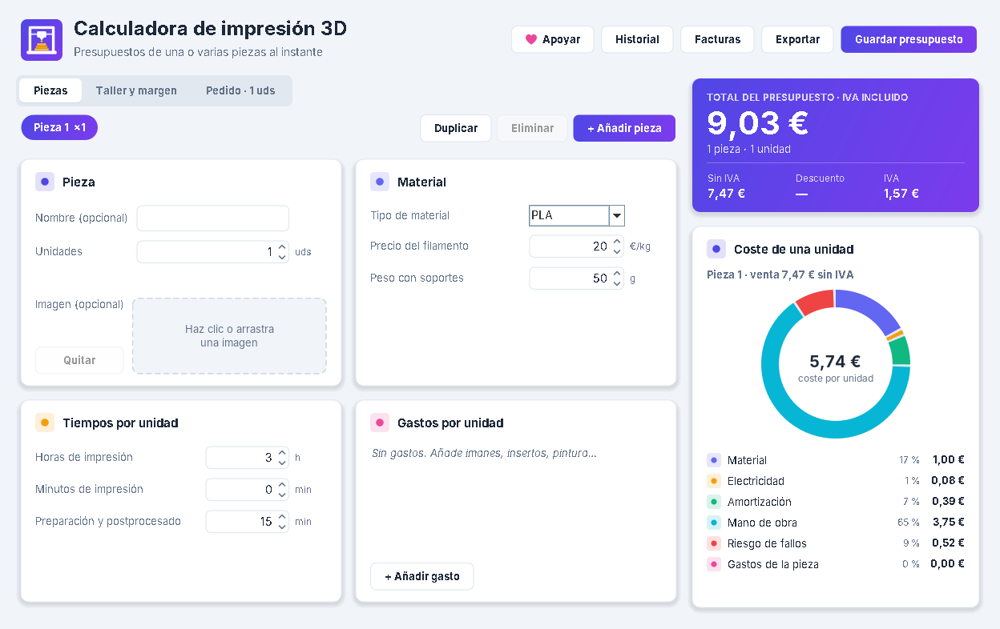

# Calculadora de impresión 3D

Aplicación de escritorio para Windows, hecha en **Java con Swing**, que calcula el precio de venta de piezas impresas en 3D y gestiona presupuestos y facturas.

**[Descargar para Windows](../../releases/latest)**: descomprime el .zip y abre `Calculadora3D.bat`. No hace falta instalar Java, va incluido.



## Qué hace

- **Cálculo del coste real de una pieza**: material, electricidad, amortización y mantenimiento de la impresora, mano de obra y un porcentaje de riesgo de fallos.
- **Precio de venta** con margen de beneficio, gastos adicionales por pieza (imanes, insertos, pintura...) e IVA.
- **Presupuestos de varias piezas**, cada una con sus unidades, gastos del pedido y **descuentos por volumen** configurables por tramos.
- **Desglose visual** del coste con un gráfico de anillo.
- **Historial** de presupuestos guardados, con nombre e imagen de la pieza.
- **Facturas** con numeración anual correlativa (`2026-0001`, `2026-0002`...), datos del emisor y del cliente.
- **Exportación a PDF y CSV** (el CSV se abre directamente con Excel).

## Arquitectura

Proyecto Gradle con dos módulos:

| Módulo | Tecnología | Contenido |
| --- | --- | --- |
| `nucleo` | Java 17 puro | Modelo de datos, cálculo de precios, pedidos, facturas, persistencia e importación/exportación CSV. Sin dependencias. |
| `escritorio` | Java 17 + Swing | Interfaz con tema propio, diálogos de historial, facturas y exportación a PDF. |

La lógica de negocio está separada de la interfaz: toda la fórmula de precios vive en [`CalculadoraPrecio`](nucleo/src/main/java/com/impresion3d/modelo/CalculadoraPrecio.java), así que el núcleo se puede reutilizar con otra interfaz sin tocar los cálculos.

## Cómo ejecutarlo

Requisitos: JDK 17 o superior.

**Escritorio (Gradle):**

```bash
gradle :escritorio:run
```

**Escritorio (sin Gradle):**

```bash
javac --release 17 -encoding UTF-8 -d out $(find nucleo/src escritorio/src -name "*.java")
java -cp out com.impresion3d.Main
```

**Paquete para Windows con Java incluido:**

```powershell
powershell -ExecutionPolicy Bypass -File empaquetar.ps1 -Version 1.0
```

Genera `dist/Calculadora3D-<versión>-Windows.zip`, que se puede repartir y usar sin instalar Java.

## Datos del usuario

La app guarda la configuración, el historial (`historial.csv`) y las imágenes en `~/.calculadora3d/`. Para hacer copia de seguridad basta con copiar esa carpeta.

## Autor

Antonio Pastor, estudiante de Ingeniería Informática en la UCAM.
